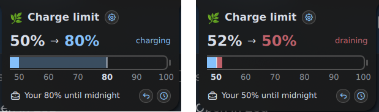

# chargelimit 🌿

Keeps your laptop battery at a charge limit you pick, like 60 % or 80 %, and plans
when to charge higher. It runs as a small system service on Linux, with a CLI and a
panel for the [Noctalia](https://github.com/noctalia-dev/noctalia) shell (v4 and
v5).

It is tested on a Framework Laptop 13 Pro and a ThinkPad T14 Gen 5. It should work on
any laptop whose kernel exposes `charge_control_end_threshold` in
`/sys/class/power_supply/BAT*`, which includes many ASUS, Dell, Samsung, LG, and
System76 models.

<p align="center">
  
</p>

## What it does

- **A limit:** pick 50 to 100 % in 10 % steps. Charging stops there.
- **Draining:** if the battery is above a new, lower limit, it drains down to it,
  even when plugged in. A Framework does that by itself. Other laptops do it when the
  kernel offers `force-discharge` in `charge_behaviour`, and only with one battery.
- **Charge by a time:** like 80 % by 13:00. The limit stays where it is until the
  last moment it needs, then rises. After the deadline it holds the target until you
  unplug.
- **Working hours:** hold one limit at work, like 50 %, and reach another, like
  80 %, by the time work ends.
- **Manual choices win:** with working hours on, a limit you pick by hand holds until
  midnight. `resume` goes back on schedule right away.
- **It learns how fast you charge** from upower's history of your last few charges.

The service plans every minute, whether or not anyone is logged in. It reapplies the
limit at boot, because a Framework's BIOS resets it.

## Install

You need Linux with systemd, plus `sudo`, `pkexec`, `python3`, and `curl`.

```sh
git clone https://github.com/pwilcke/chargelimit.git
cd chargelimit
./install.sh
```

The script asks for your sudo password once. On a Framework it also downloads
Framework's official
[`framework_tool`](https://github.com/FrameworkComputer/framework-system) v0.6.6
and checks its SHA-256. Keep the folder if you use a Noctalia panel, because Noctalia
loads the plugin from it.

This project used to be called `battery-limiter-noctalia`. If you installed that
version, the script removes its helper and keeps the limit it set.

## CLI

```sh
chargelimit                         # Limit 80%. Battery 63%, charging.
chargelimit set 60
chargelimit charge-by 80 13:00      # or: chargelimit charge-by off
chargelimit resume                  # drop today's manual choice
chargelimit config work-hours=on work-days=weekdays work-start=08:00 work-end=16:00 \
    work-limit=50 after-work-limit=80 tolerance=3 learn-rates=on
chargelimit status --json
```

Any active local session can change the limit without a password.

## Noctalia panel

Click the battery icon in your bar, pick a limit, done. The big number is the charge.
While the battery charges or drains, an arrow shows where it is heading, like
`63% → 80%`. The gauge shows the battery from 50 to 100 %: the solid part is the
charge, and the thin line is the limit.

- **Hover** a preset to preview it. **Click** to apply it.
- **Red** marks charge that a lower limit would drain.
- **Left/Right**, Home and End work too. In the "charge by" editor, Up and Down change
  the target.
- The gear opens the settings for working hours. With a panel installed, its settings
  own the schedule: they overwrite what `chargelimit config` set when you change
  them or restart the shell.

### Noctalia Shell v5

Noctalia 5.3 or newer must be running.

```sh
noctalia/v5/install.sh
```

A left-click on the battery icon opens the panel. A right-click still opens
Noctalia's power tab.

### Noctalia Shell v4

Noctalia Shell 4.7 must be running.

```sh
noctalia/v4/install.sh
```

Then restart Noctalia and enable Charge Limit in Settings > Plugins > Installed. This
adds a second battery icon to your bar. Remove the built-in Battery widget and move
the new one to its place. v4 cannot change what a click on its own battery icon does,
so the plugin brings an icon that looks the same. In the icon display modes, that icon
also shows the arrow while the battery charges or drains, like `49% → 70%`. Battery
widget options, like `"displayMode": "icon-always"`, go in
`noctalia/v4/chargelimit/settings.json`.

## Good to know

- Charging resumes 5 % below the limit, and at 100 % it always charges.
- Other tools that set the limit, like TLP, fight with this one. Use one.
- A laptop asleep on AC while draining keeps draining slowly, so it can wake a few
  percent below the limit.

<details>
<summary><b>Uninstall</b></summary>

```sh
sudo systemctl disable --now chargelimit.service
sudo rm -rf /etc/systemd/system/chargelimit.service /usr/local/bin/chargelimit \
    /usr/local/libexec/chargelimit-framework-tool \
    /usr/share/polkit-1/actions/dev.chargelimit.write.policy \
    /var/lib/chargelimit /run/chargelimit
sudo systemctl daemon-reload
```

Noctalia v5: `noctalia msg plugins source remove chargelimit`, then delete
`chargelimit.toml` in your Noctalia config folder. Noctalia v4: disable Charge Limit
in Settings > Plugins, then delete `~/.config/noctalia/plugins/chargelimit`.

The limit stays where you last set it until the next reboot.
</details>

## Development

[ARCHITECTURE.md](ARCHITECTURE.md) is the map of the code. The Noctalia v5 tests need
the [Luau CLI](https://github.com/luau-lang/luau/releases):

```sh
python3 -m unittest test_chargelimit
python3 noctalia/v5/test_service.py /path/to/luau
python3 noctalia/v5/test_panel.py /path/to/luau
python3 noctalia/v5/test_clock.py /path/to/luau
node --test noctalia/v4/test_clock.js
```

MIT licensed.
