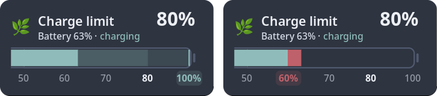
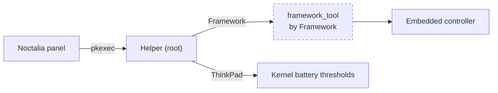

# Framework Charge for Noctalia 🌿

A small [Noctalia](https://github.com/noctalia-dev/noctalia) panel for the
battery charge limit of your Framework laptop or ThinkPad. Click the battery icon in your bar,
pick a limit, done.

<p align="center">
  
</p>

The big number is the limit. The gauge shows the battery from 50 to 100%: the
solid part is the charge, and the thin line is the limit. The v5 panel, shown
above, also has a line under the title with the battery level and whether it is
charging, holding, draining, or on battery. Its presets are evenly spaced, so
the stretch from 80 to 100 is drawn at half scale.

- **Hover** a preset to preview it. The line glides there.
- **Click** to apply it. A spinner turns until the laptop confirms.
- **Red** marks charge that a lower limit would drain. Only a Framework drains.
- **Left/Right**, Home and End work too.

## Install

Pick the folder for your Noctalia Shell version. Both install the same helper.

### Noctalia Shell v5

You need Noctalia 5.3 or newer running, plus `sudo`, `pkexec`, `python3`, and
`curl`.

```sh
git clone https://github.com/pwilcke/battery-limiter-noctalia.git
cd battery-limiter-noctalia/v5
./install.sh
```

The script asks for your sudo password once, to install the helper. After
that, left-click the battery icon in your bar. Right-click still opens
Noctalia's power tab. Keep the folder where it is, because Noctalia loads the
plugin from it.

### Noctalia Shell v4

You need Noctalia Shell 4.7 running, plus `sudo`, `pkexec`, `python3`, and
`curl`.

```sh
git clone https://github.com/pwilcke/battery-limiter-noctalia.git
cd battery-limiter-noctalia/v4
./install.sh
```

The script asks for your sudo password once, to install the helper. It then
links the plugin into Noctalia's plugin folder. Then:

1. Restart Noctalia.
2. Enable Framework Charge in Settings > Plugins > Installed. This adds a
   second battery icon to your bar.
3. Remove the built-in Battery widget from the bar, and move the new one to
   its place.

v4 cannot change what a click on its own battery icon does, so the plugin
brings a battery icon that looks the same. Left-click opens the charge panel.
Right-click still opens Noctalia's battery menu. Battery widget options, like
`"displayMode": "icon-always"`, go in `v4/framework-charge/settings.json`.
Keep the folder where it is, because the link points into it.

## How it works



The panel has no hardware access of its own. It asks a small root helper,
through Polkit, to read the limit or to set one of five presets. On a
Framework, the helper calls `framework_tool`, which talks to the laptop's
embedded controller. On a ThinkPad, it writes the battery's charge thresholds
in `/sys/class/power_supply`. The helper also saves the limit you pick, and a
small system service applies it again at every boot, because a Framework's
BIOS resets it.

[`framework_tool`](https://github.com/FrameworkComputer/framework-system) is
Framework's official command-line tool. It is a separate project and not part
of this repo. On a Framework, `helper/install.sh` downloads its v0.6.6
release and checks the SHA-256 before installing it. This plugin was built on a Framework laptop, so
Framework's own tool was the natural backend.

## Good to know

- On Framework, the helper only runs on the Framework Laptop 13 Pro (Intel
  Core Ultra Series 3), the model this was built and tested on.
  `framework_tool` supports other Framework laptops. To try yours, change the
  model check in `helper/framework-charge-limit`.
- On ThinkPad, the helper runs on any model whose kernel exposes
  `charge_control_end_threshold`. It was built on a ThinkPad T14 Gen 5.
  Charging resumes 5% below the limit, and at 100% it always charges.
- If you pick a limit below the current charge, a Framework drains down to it,
  even when plugged in. A ThinkPad stops charging and keeps its level, so its
  gauge shows no red.
- The last limit you picked survives reboots. The boot service reapplies it,
  even if you changed the limit in the BIOS since.
- Other tools that set the limit, like TLP, can overwrite it.
- Any active local session can read the limit or pick a preset without a
  password.

<details>
<summary><b>Uninstall</b></summary>

Remove the plugin from Noctalia Shell v5:

```sh
noctalia msg plugins source remove framework-charge
rm ~/.config/noctalia/framework-charge.toml  # in your Noctalia config folder
noctalia msg config-reload
```

Or from Noctalia Shell v4: disable Framework Charge in Settings > Plugins, then

```sh
rm ~/.config/noctalia/plugins/framework-charge  # in your Noctalia config folder
```

Then remove the helper:

```sh
sudo systemctl disable --now framework-charge-limit.service
sudo rm -f /etc/systemd/system/framework-charge-limit.service \
    /usr/local/libexec/framework-charge-limit /usr/local/libexec/framework-charge-tool \
    /usr/share/polkit-1/actions/dev.noctalia.framework-charge-limit.policy
sudo rm -rf /var/lib/framework-charge-limit
sudo systemctl daemon-reload
```

The charge limit stays where you last set it until the next reboot.
</details>

## Development

[ARCHITECTURE.md](ARCHITECTURE.md) is the map of the code. The tests need the
[Luau CLI](https://github.com/luau-lang/luau/releases):

```sh
python3 -m unittest helper/test_helper.py
python3 v5/test_panel.py /path/to/luau
noctalia plugins lint framework-charge  # run inside v5/
```

MIT licensed.
